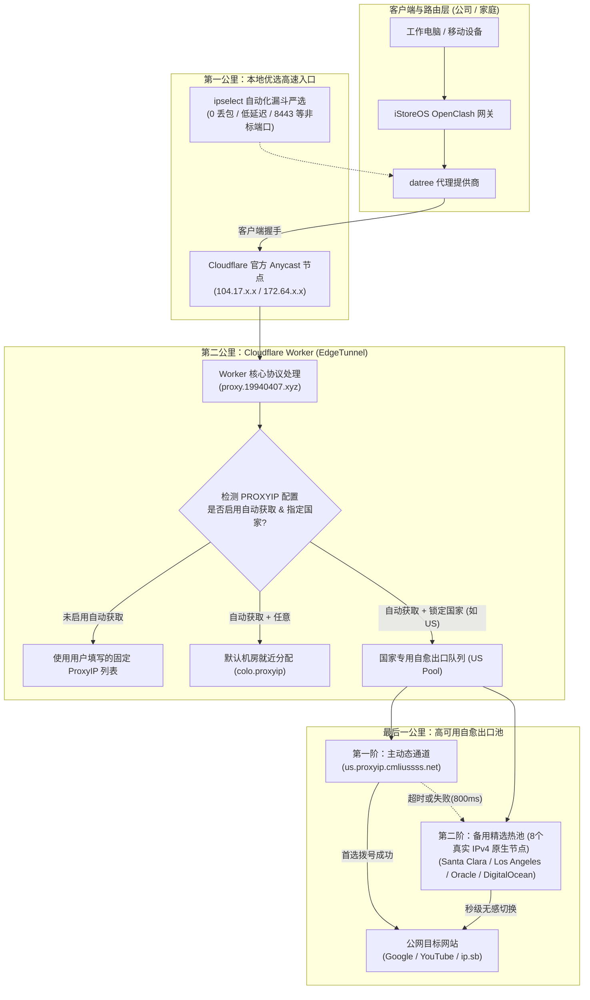

# EdgeTunnel 目标国家出口选择与高可用自动保活系统设计规范

## 一、 背景与业务目标

### 1.1 背景现状
在目前的 Cloudflare Worker 代理链路中：
* **本地第一公里（入口优选）**：由 `ipselect` 自动化脚本在路由器本地绕过代理，对 Cloudflare 官方 Anycast IP 进行四阶漏斗严选（TCP 握手、机房代码校验、稳定性与微测速），生成 Top 15 最优进站节点（例如 `US-DaTree-xx-公司`、`US-DaTree-xx-家庭`）。
* **云端最后一公里（出口反代）**：由部署在 Cloudflare Worker 的 `edgetunnel`（`proxy.19940407.xyz`）承载。由于 Cloudflare 内部限制，Worker 直连公网需通过 `ProxyIP` 进行二次转发。
* **痛点问题**：
  1. **出口漂移**：原版 EdgeTunnel 的【启用自动获取】是基于客户端接入机房代码（`colo`）动态分配的。国内宽带连接经常被 BGP 路由就近牵引到香港（HKG），导致实际落地出口自动漂移到香港，无法满足用户锁定美国原生出口的刚需。
  2. **静态死锁与单点故障**：若在面板中手动写死特定几个 ProxyIP，一旦该批 IP 遭遇网络波动、被 Google/YouTube 风控或服务宕机，所有通过该 Worker 的节点将全盘瘫痪（表现为 TLS 握手断开、网页转圈）。

### 1.2 建设目标
1. **职责分离（解耦）**：本地 `ipselect` 纯粹专注本地宽带入口严选；云端 `edgetunnel` 独立负责出口国家锁定与健康保活。公司与家庭环境各自独立生成 15 个入口，共享云端美区自愈出口池。
2. **面板交互友好**：在 EdgeTunnel 管理后台（`/admin`）的【启用自动获取】旁新增【指定落地国家】下拉菜单（支持美国、英国、日本、新加坡等，默认锁定 `🇺🇸 美国 (US)`）。
3. **毫秒级故障转移与自愈（Failover）**：后端建立“主动态通道 + 备用高可用热池”的多阶队列。单个出口故障时，Worker 在毫秒级内自动顺延重试下一个出口，客户端 0 感知，保障 7×24 小时不掉线。

---

## 二、 整体架构拓扑与全链路数据流



---

## 三、 详细功能模块设计

### 3.1 模块一：管理面板 UI 增强设计 (`admin_page.html` 注入层)

#### 1. 注入位置与 DOM 结构
在 `_worker.js` 的 `增强管理后台HTML` 函数中，对 `#proxyIPSection` 内部的自动获取控制区进行 DOM 变换：
```html
<div class="checkbox-group proxy-auto-group" style="display: flex; align-items: center; gap: 12px; margin-top: 8px;">
    <!-- 原始自动获取复选框 -->
    <label class="checkbox-container">
        <input type="checkbox" id="autoProxy" title="启用自动获取" onchange="toggleAutoProxy(); markModified('proxy')">
        <span class="checkbox-label">启用自动获取</span>
    </label>

    <!-- 新增国家选择下拉控件 -->
    <div id="proxyCountryWrapper" style="display: inline-flex; align-items: center; gap: 6px;">
        <label for="proxyCountrySelect" style="font-size: 13px; color: #9ca3af;">🏳️ 落地国家:</label>
        <select id="proxyCountrySelect" class="form-select-sm" style="padding: 4px 8px; border-radius: 6px; font-size: 13px; background: rgba(255,255,255,0.08); color: #fff; border: 1px solid rgba(156,163,175,0.3);" onchange="markModified('proxy')">
            <option value="US" selected>🇺🇸 美国 (US)</option>
            <option value="auto">🌐 任意 (就近)</option>
            <option value="GB">🇬🇧 英国 (GB)</option>
            <option value="JP">🇯🇵 日本 (JP)</option>
            <option value="SG">🇸🇬 新加坡 (SG)</option>
            <option value="HK">🇭🇰 香港 (HK)</option>
        </select>
    </div>
</div>
```

#### 2. UI 交互状态联动
* **当勾选【启用自动获取】时**：
  * `#proxyIP` 输入框禁用 (`disabled = true`)；
  * `#proxyCountrySelect` 启用 (`disabled = false`)，高亮显示；
* **当取消勾选【启用自动获取】时**：
  * `#proxyIP` 输入框恢复可编辑 (`disabled = false`)；
  * `#proxyCountrySelect` 禁用 (`disabled = true`)；
* **数据持久化绑定**：
  * 在面板点击【保存配置】时，向服务端提交的数据结构包含：
    * `反代.PROXYIP = autoProxy ? 'auto' : customValue`
    * `反代.PROXYIP_COUNTRY = document.getElementById('proxyCountrySelect').value`
  * 面板加载配置时，读取 `currentConfig.反代?.PROXYIP_COUNTRY || 'US'` 进行回显。

---

### 3.2 模块二：Worker 后端路由与自愈队列引擎 (`_worker.js`)

#### 1. 出口队列构建算法
在处理接入连接时，根据环境配置动态构建候选反代数组：

```javascript
// 出口队列构建逻辑 (伪代码规范)
function 获取出口反代候选队列(request, env, ctx反代IP) {
    // 1. 若 URL path 中明确带有 /proxyip= 则优先级最高（节点级显式指定）
    if (ctx反代IP && ctx反代IP !== 'auto') {
        return 整理成数组(ctx反代IP);
    }

    // 2. 检查全局配置
    const isAuto = (env.PROXYIP === 'auto' || !env.PROXYIP);
    const country = (env.PROXYIP_COUNTRY || 'US').toUpperCase();

    if (isAuto && country !== 'AUTO') {
        // 构建国家专属高可用队列
        const dynamicDomain = `${country.toLowerCase()}.proxyip.cmliussss.net`;
        const staticBackup = 国家静态高可用热池[country] || 国家静态高可用热池['US'];
        
        // 动态域名排首位，静态热备按随机打散紧随其后
        return [dynamicDomain, ...shuffleArray(staticBackup)];
    }

    // 3. 默认任意分配 (回退到机房就近分配)
    const colo = (request.cf?.colo || 'sjc').toLowerCase();
    return [`${colo}.proxyip.cmliussss.net`];
}
```

#### 2. 预置美区高可用 IPv4 备用热池清单
在源码中预置经过实测验证的纯美区 IPv4 原生节点作为第二阶热备：
```javascript
const 美区高可用备用热池 = [
    "192.9.157.76:443",   // Santa Clara (Oracle)
    "206.223.84.247:443",  // Los Angeles (NetLab)
    "113.20.6.129:443",    // Los Angeles (Multacom)
    "64.227.109.151:443",  // Santa Clara (DigitalOcean)
    "43.153.78.145:443",   // Santa Clara (Tencent Cloud US)
    "138.2.236.17:443",    // Santa Clara (Oracle)
    "45.32.67.85:443",     // Los Angeles (Vultr)
    "38.180.204.104:443"   // Chicago (HIVELOCITY)
];
```

#### 3. 毫秒级重试与故障转移机制
在 `connectProxyIP` 连接函数中：
* 对候选数组依次拨号；
* 单个 IP 握手超时限制设为 `1000ms`；
* 若第 1 个节点握手失败，捕获异常后不向外中断，立即触发 `i++` 顺延尝试第 2 个备用节点；
* 成功建立 TCP 隧道后立即退出循环并开始双向数据转发。

---

## 四、 异常处理与容错保证

1. **IPv4 严格保障**：备用热池中的所有 IP 严格筛选为具备 IPv4 出站能力（禁止录入纯 IPv6 的 `🔴✅` 节点），彻底解决此前 `unexpected eof while reading` 错误。
2. **全局降级兜底**：若特定国家的所有主备出口在极端情况下均不可通，触发全局兜底逻辑，使用 `colo.proxyip.cmliussss.net` 兜底，保证不断网。
3. **ECH 容错**：优化生成的 Clash 配置，移除或设为宽松的 ECH 配置，避免本地 DoH 解析失败拖累代理握手。

---

## 五、 测试与部署验证计划

1. **阶段 1：本地单元与 DOM 转换测试**
   * 创建 `tests/test_country_ui.js`，运行模拟测试，确认 `增强管理后台HTML` 能正确将国家选择下拉框注入并绑定事件；
   * 创建 `tests/test_country_routing.js`，验证在不同环境变量组合下（`PROXYIP=auto`、`PROXYIP_COUNTRY=US`），路由算法返回正确的优先级队列。
2. **阶段 2：发布部署**
   * 将修改更新至 `D:\nice_wall\edgetunnel\_worker.js`；
   * 部署方式：
     * **方式 A (推荐)**：使用 `npx wrangler login` 授权一次后执行 `npx wrangler deploy`；
     * **方式 B**：在 Cloudflare 控制台直接粘贴更新后的 `_worker.js` 保存部署。
3. **阶段 3：影子沙箱全链路回归测试**
   * 在软路由使用 `17890` 独立端口执行自动化测试；
   * 依次请求 `ip.sb`、`google.com`、`youtube.com`，确认 HTTP 状态码均为 `200`，落地 IP 归属地 100% 为美国加州/芝加哥等机房。
